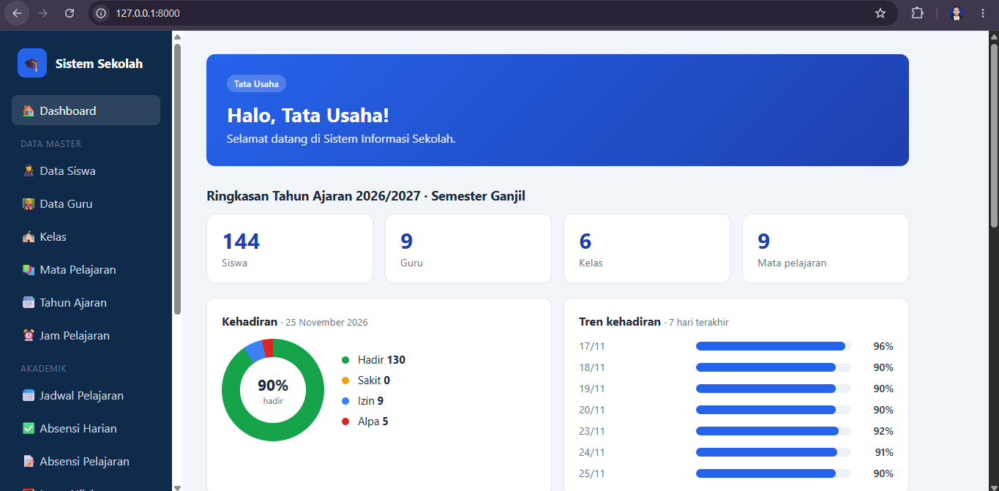
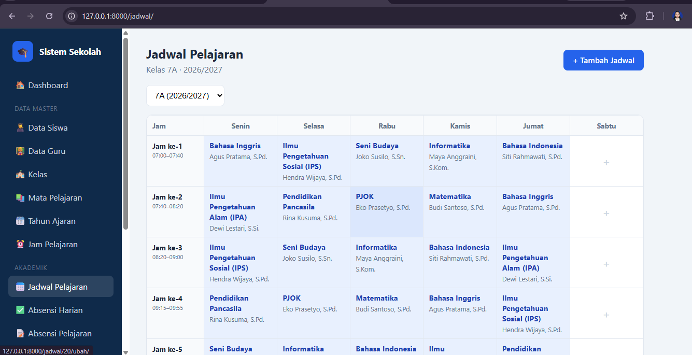
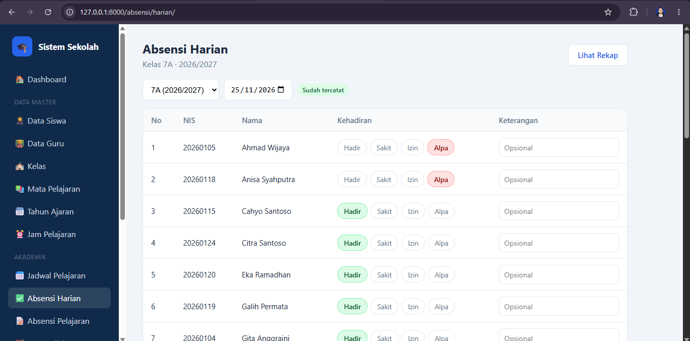
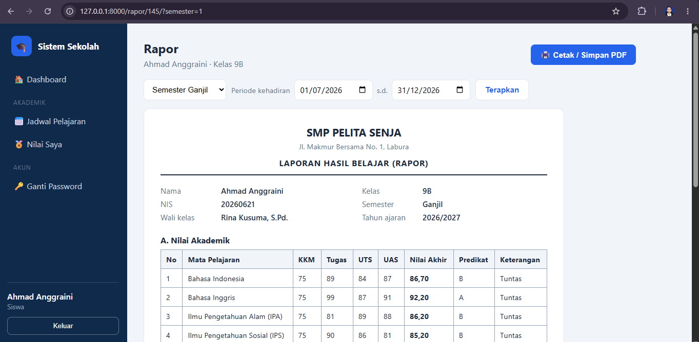
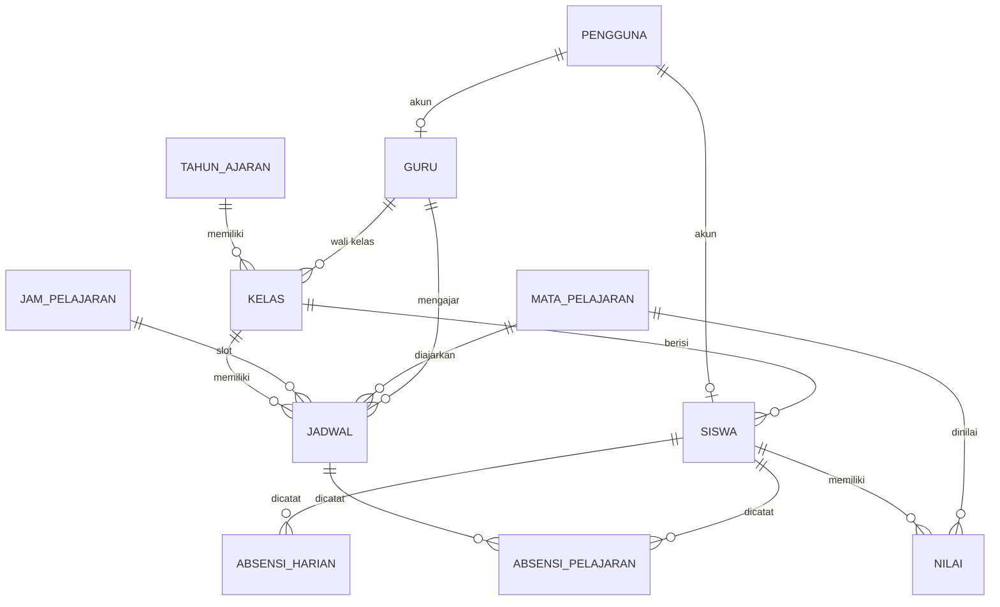

# Sistem Informasi Sekolah

Aplikasi web untuk mengelola kegiatan akademik sekolah menengah pertama: data siswa dan guru, jadwal pelajaran, absensi harian dan per pelajaran, nilai, rapor, serta dashboard statistik. Dibangun dengan **Django (Python)**.

> Proyek portfolio. Dibuat dari nol sebagai latihan merancang sistem informasi yang realistis, mulai dari autentikasi hingga pelaporan.

**Demo:** ⟨https://penni.pythonanywhere.com⟩

## Tampilan

| Dashboard TU                                 | Jadwal pelajaran                       |
| -------------------------------------------- | -------------------------------------- |
|  |  |

| Absensi harian                           | Rapor                                |
| ---------------------------------------- | ------------------------------------ |
|  |  |

## Fitur

**Tata Usaha (TU)**

- Kelola data siswa, guru, kelas, mata pelajaran, tahun ajaran, dan jam pelajaran
- Akun login siswa dan guru **dibuat otomatis**; reset password dengan satu klik
- Susun jadwal mingguan per kelas, dengan **pengecekan bentrok** guru dan kelas
- Dashboard statistik: kehadiran, tren, rata-rata nilai per kelas, ketuntasan per mata pelajaran, siswa yang perlu perhatian

**Guru**

- Melihat jadwal mengajar
- Absensi harian (wali kelas) dan absensi per pelajaran, plus rekap bulanan
- Input nilai Tugas, UTS, dan UAS; nilai akhir dihitung otomatis
- Leger nilai dan rapor siswa kelas perwalian

**Siswa**

- Melihat jadwal pelajaran, nilai per semester, dan mencetak rapor sendiri

**Keamanan**

- Tiga peran dengan pembatasan akses di sisi server (halaman terlarang menghasilkan 403)
- Password awal wajib diganti pada login pertama
- Guru hanya dapat mengisi absensi dan nilai untuk kelas dan mata pelajaran yang ia ajar
- Rahasia aplikasi dibaca dari variabel lingkungan

## Teknologi

- Python 3 dan Django
- SQLite (pengembangan), siap dipindah ke PostgreSQL untuk produksi
- HTML, CSS, dan sedikit JavaScript tanpa kerangka kerja tambahan; grafik dibuat dengan CSS murni
- Agregasi data dengan Django ORM (`GROUP BY`, `AVG`, hitung bersyarat) yang diterjemahkan menjadi SQL

## Menjalankan di komputer sendiri

Prasyarat: Python 3 dan Git.

```powershell
git clone https://github.com/penniii/sistem-informasi-sekolah.git
cd sistem-informasi-sekolah

python -m venv venv
venv\Scripts\activate
pip install -r requirements.txt

python manage.py migrate
python manage.py createsuperuser
python manage.py isi_data_contoh
python manage.py runserver
```

Buka `http://127.0.0.1:8000`.

Di macOS atau Linux, aktifkan lingkungan virtual dengan `source venv/bin/activate`.

### Data contoh dan akun demo

Perintah `python manage.py isi_data_contoh` membuat 144 siswa, 9 guru, 6 kelas, jadwal, absensi 20 hari kerja terakhir, dan nilai semester berjalan. Sandi semua akun demo: **`demo12345`**.

| Peran                | Username             |
| -------------------- | -------------------- |
| TU                   | `tu.demo`            |
| Guru (wali kelas 7A) | `197106152010010001` |
| Siswa (kelas 7A)     | `20260101`           |

Tambahkan `--reset` untuk menghapus data akademik dan mengisinya ulang.

## Struktur proyek

```
config/        Pengaturan proyek dan daftar alamat utama
akun/          Pengguna, peran, login, dan pembatasan akses
akademik/      Data master, jadwal, absensi, nilai, rapor, statistik
  management/  Perintah isi_data_contoh
templates/     Tampilan HTML
static/        CSS dan JavaScript
```

## Rancangan database



Beberapa keputusan rancangan:

- Satu catatan absensi per siswa per hari (dan per jadwal per siswa per hari), dijaga oleh batasan unik di database
- Nilai akhir disimpan saat nilai disimpan, sehingga leger dan rapor cepat dibuka
- Data yang masih dipakai tidak bisa dihapus (`PROTECT`), misalnya guru yang masih punya jadwal

## Pengembangan selanjutnya

- Tes otomatis untuk perhitungan nilai dan pembatasan akses
- Pengumuman dan agenda sekolah
- Impor data siswa dari Excel
- Pemindahan ke PostgreSQL untuk penggunaan produksi

## Pembuat

Penni Wintasari Simarmata
